# Machine Learning desde Primeros Principios en JAX para Software Devs: De Reglas Fijas a tu Primera Red Neuronal en 100 Líneas

- **Por qué es relevante:** La mayoría de cursos presentan Machine Learning como una caja negra de capas prefabricadas. Para un ingeniero de software que ya conoce `jax.numpy`, `@jax.jit`, `jax.grad` y `jax.vmap` ([jax-for-software-devs](https://github.com/ykro/jax-for-software-devs)), un modelo de Machine Learning se entiende mucho mejor como una función parametrizada cuyos argumentos `params` se ajustan automáticamente minimizando una `loss function` con derivadas exactas.
- **Para quién es:** Desarrolladores de software, ingenieros backend y arquitectos de sistemas que quieren construir intuición matemática e ingenieril sólida sobre regresión, `SGD`/`Momentum`/`Adam`, estabilidad numérica `LogSumExp`, redes `MLP` y regularización `weight decay` en JAX puro sin depender de PyTorch.
- **Quién debería verlo:** Equipos de ingeniería que necesitan reemplazar cadenas frágiles de reglas `if/else` por modelos aprendidos desde telemetría real, diagnosticar problemas de `overfitting` y preparar la base antes de diseñar arquitecturas modernas con Flax NNX.
- **Serie completa:** Segunda entrega del [JAX & ML for Software Devs Field Guide](https://github.com/ykro/jax-ml-for-software-devs-field-guide).

---

## Arquitectura y Modelo Mental

### 1. De Heurísticas `if/else` Manuales a un `Training Loop` con Pesos Aprendidos

En ingeniería de software tradicional escribimos reglas fijas (`if cpu > 0.75: latency += 14.0`) y las combinamos con los datos de entrada para producir una respuesta. Cuando el sistema cambia, un humano tiene que adivinar nuevos umbrales. En Machine Learning invertimos el flujo, entregamos los datos de entrada junto con las respuestas históricas observadas, medimos la distancia cuadrática media (`MSE`) y dejamos que `jax.value_and_grad` descubra los pesos óptimos `w, b` dentro de un `training loop` compilado con `@jax.jit`.



### 2. Dataflow Forward y Backward de una Red Neuronal (`MLP` de 2 Capas)

Apilar dos multiplicaciones de matrices sin una activación intermedia colapsa algebraicamente en una sola transformación lineal `(X @ W1) @ W2 == X @ (W1 @ W2)`. Al intercalar una no-linealidad como `jax.nn.gelu` y calcular la pérdida con el truco numérico `LogSumExp`, una red neuronal de 2 capas en 80 líneas de JAX deforma el espacio de representación y resuelve fronteras de decisión curvas con `99.47%` de exactitud en entrenamiento y `99.07%` en un conjunto de test que nunca vio.



### 3. Diagnóstico de `Overfitting` con `Train/Val Split`, `Weight Decay` y `Validation Gate`

Evaluar un modelo sobre el mismo conjunto de datos con el que se calculan los gradientes equivale a probar software únicamente contra mocks estáticos. Cuando el modelo tiene más grados de libertad que señal real, memoriza el ruido del `train set` y dispara el error en producción. La combinación de un `Train/Val Split` estricto, penalización `L2 Weight Decay` sobre la norma de los pesos y un `Validation Gate` (`early stopping`) restaura la capacidad de generalización.



---

## Resultados Reales de Verificación (`verify_ml_principles.py`)

Una corrida de `make all` en CPU (`Apple M1 Max`, 10 núcleos, load average de 1 minuto `24.85` al empezar), Python `3.12.11`, JAX `0.12.0.1` y NumPy `2.5.4`. Las cifras de esta tabla son las de `benchmarks/latest_results.json`.

| Experimento | Baseline ingenuo | Resultado en JAX | Referencia justa |
| :--- | :--- | :--- | :--- |
| **01. Reglas vs pesos aprendidos (`MSE`)** | Regla `if/else` con coeficientes adivinados, `531.3102 ms²` | `0.3949 ms²` tras 250 pasos de gradient descent (**1345.28x menos error que la regla**) | Mínimos cuadrados en forma cerrada `0.3754 ms²` (el mejor ajuste lineal posible); piso de ruido `0.3764 ms²`. El modelo aprendido queda `5.2%` arriba del óptimo |
| **02. `SGD` vs `Momentum` vs `Adam`** | `SGD` termina en `8.5645`, `Momentum` en `0.4526` (ninguno baja de `0.05` en 180 pasos) | `Adam` cruza `0.05` en el paso `79` | Cada optimizador con su mejor learning rate de la misma rejilla: `SGD` no llega, `Momentum` paso 171, `Adam` paso 69 |
| **02. Tiempo del mismo trabajo** (3 optimizadores × 180 pasos) | Loop eager op por op: `1426.97 ms` | `@jit` + `lax.scan`: `2.43 ms` (**588.37x**) | Loop de Python sobre un paso con `@jit`: `5.19 ms`, el scan es **2.14x** más rápido |
| **03. `LogSumExp` y clasificación** | `softmax` ingenuo con un logit de 120 devuelve `[0.0, 0.0, nan]` | `log_softmax` estable `[-110.0, -100.0, 0.0]`, diferencia `0.0e+00` contra `jax.nn.log_softmax` | Accuracy `33.33%` con pesos en cero → `99.94%` en entrenamiento y `100.00%` en test (900 muestras nuevas) |
| **04. `MLP` de 2 capas vs colapso lineal** | 2 capas sin activación: `32.53%` train / `30.60%` test (`Δ = 1.43e-06` contra una sola matriz) | `MLP` con `GELU`: `99.47%` train / `99.07%` test | Con todos los pesos en cero, `1` de `64` neuronas distintas y `33.33%`; con init de He, `64` de `64` |
| **05. `Overfitting` vs `weight decay` + validation gate** | Sin regularizar: train `0.2900`, val `9.9728` (brecha `34.39x`) | `wd=0.35` + gate: val `2.2289` (**4.47x** menos, con el gate eligiendo sobre val) | Test que ninguna decisión tocó: `9.9810` → `2.9337` (**3.40x**); `weight decay` solo `2.7368`, gate solo `2.9292` |

### Cómo leer estas cifras

- **Las métricas de calidad son deterministas.** MSE, pérdidas, accuracy y normas salen de datos sintéticos con semillas fijas y se repiten igual en cada corrida en CPU. Los datos vienen de fórmulas conocidas a propósito, para comprobar si el modelo encuentra la respuesta correcta.
- **Los tiempos no son deterministas.** Cada tiempo es la mediana después de una llamada de calentamiento (`block_until_ready()` en todas las ramas de JAX) y cambia entre corridas, sobre todo con la máquina cargada. Cada script imprime su propia medición, así que sus tiempos no coinciden con los de esta tabla. Importa el orden de magnitud.
- **Cada «Nx» dice contra qué compara.** El `1345.28x` del 01 mide lo mala que era la regla adivinada; la comparación justa es contra mínimos cuadrados. El `588.37x` del 02 compara contra Python despachando cada operación una por una; contra un loop que ya llama a un paso compilado, `lax.scan` gana `2.14x`. Ninguna corrida extrapola: los tres caminos ejecutan los 180 pasos completos.
- **El 02 compara optimizadores con learning rates elegidos a mano** y también con el mejor learning rate de cada uno en la misma rejilla de 33 valores. `Adam` gana en los dos casos porque cada eje de este problema tiene su propia escala (número de condición del Hessiano `2741.8`), justo lo que `Adam` corrige.
- **Train contra test.** La accuracy de entrenamiento se mide sobre los datos que generaron los gradientes. Los experimentos 03 y 04 también reportan un conjunto de test generado con otra semilla.
- **El validation gate mira la validación.** En el 05 el checkpoint se elige por su error de validación, así que ese número es optimista (`2.2289` en val contra `2.9337` en test). La cifra honesta es la de test, y ahí el `weight decay` solo (`2.7368`) rinde mejor que combinado con el gate. Los targets de validación y test tienen ruido `0.10` (los de entrenamiento `1.15`), así que su piso de error es `0.0103` y su MSE mide sobre todo qué tan lejos quedaron los pesos de los reales.

Salida íntegra de terminal generada por `verify_ml_principles.py` en esa corrida:

```text
============================================================================================
THE OUTSIDE JUDGE — ML from First Principles in JAX Verification Report
============================================================================================
Runtime : Python 3.12.11 | JAX 0.12.0.1 | NumPy 2.5.4 | Backend: cpu
CPU     : Apple M1 Max (10 cores) | 1-min load average 24.85 before, 21.51 after
--------------------------------------------------------------------------------------------
Experiment                     | Baseline           | JAX ML           | Result
--------------------------------------------------------------------------------------------
01. Rules vs learned (MSE)     | rules 531.3102     | learned 0.3949   | 1345.28x lower
    fair: closed-form least squares 0.3754 (learned is 5.2% above it)
02. Optimizers, 180 steps      | SGD 8.5645         | Adam 0.000001    | <0.05 at step 79
    fair: best lr each -> SGD never, Momentum step 171, Adam step 69
02. Same work, timing          | eager 1426.97 ms   | scan 2.43 ms     | 588.37x
    fair: Python loop of @jit step 5.19 ms -> scan 2.14x faster
03. LogSumExp + cross-entropy  | naive: nan         | stable: finite   | diff 0.0e+00
    accuracy 33.33% -> train 99.94%, held-out test 100.00%
04. MLP vs linear stack        | linear 32.53%      | MLP 99.47%       | train acc
    held-out test: linear 30.60%, MLP 99.07%; zero init: 1 of 64 units distinct
05. Overfit vs WD + val gate   | val 9.9728         | val 2.2289       | 4.47x lower
    fair (test set): 9.9810 -> 2.9337, 3.40x lower; WD alone 2.7368
--------------------------------------------------------------------------------------------
Quality metrics are deterministic (fixed seeds). Times are medians after a warmup
and vary run to run.
Saved JSON report to: benchmarks/latest_results.json
ALL DETERMINISTIC CHECKS PASSED.
```

---

## Estructura del Repositorio

```text
.
├── benchmarks/
│   ├── latest_results.json                              # Métricas verificadas por verify_ml_principles.py
│   └── terminal_output.txt                              # Salida íntegra del Outside Judge
├── diagrams/
│   ├── 01-rules-vs-learned-loop.{html,svg,png}
│   ├── 02-mlp-forward-backward-dataflow.{html,svg,png}
│   └── 03-overfitting-vs-regularization.{html,svg,png}
├── experiments/
│   ├── 01_rules_vs_learned_weights.py                   # De reglas if/else manuales a regresión lineal con MSE
│   ├── 02_gradient_descent_geometry.py                  # SGD, Momentum y Adam en 30 líneas de PyTrees puros
│   ├── 03_logistic_classification_cross_entropy.py      # Desbordamiento float32 en Softmax, LogSumExp y Cross-Entropy
│   ├── 04_two_layer_mlp_from_scratch.py                 # Colapso lineal vs MLP de 2 capas con GELU e init de He
│   └── 05_overfitting_and_weight_decay.py               # Overfitting en 28 métricas ruidosas vs L2 Weight Decay
├── gcp/
│   └── run_on_demand_ml.sh                              # Runner on-demand con auto-teardown en Cloud TPU v5e y L4 GPU
├── tests/
│   └── test_ml_principles.py                            # Suite pytest determinista (5 tests)
├── Makefile
├── pyproject.toml
└── verify_ml_principles.py                              # El Outside Judge (aserciones de convergencia y generalización)
```

---

## Onboarding Paso a Paso

### 1. Instalación desde cero (macOS / Linux)

```bash
git clone https://github.com/ykro/ml-from-first-principles-in-jax.git
cd ml-from-first-principles-in-jax
python3 -m venv .venv
source .venv/bin/activate
pip install --upgrade pip
pip install -e ".[dev]"
```

### 2. Recorrido guiado por los 5 experimentos (Orden recomendado)

Cada script está diseñado como una lección autocontenida que corre en unos segundos en CPU (el 02 tarda más porque mide el loop eager completo):

```bash
# Paso 1 — De heurísticas if/else escritas a mano a pesos aprendidos con MSE y value_and_grad
python experiments/01_rules_vs_learned_weights.py

# Paso 2 — Geometría de optimización: SGD vs Momentum vs Adam con jax.tree.map, barrido de learning rate y tres formas de correr el loop
python experiments/02_gradient_descent_geometry.py

# Paso 3 — De números a probabilidades: por qué exp() falla en float32 y cómo funciona LogSumExp
python experiments/03_logistic_classification_cross_entropy.py

# Paso 4 — Tu primera red neuronal (MLP de 2 capas) y por qué hacen falta activaciones no lineales
python experiments/04_two_layer_mlp_from_scratch.py

# Paso 5 — Cómo detectar y corregir overfitting con Train/Val Split, Weight Decay y Validation Gate
python experiments/05_overfitting_and_weight_decay.py
```

### 3. Verificación completa (Linter + Tests + Outside Judge)

```bash
# Ejecutar únicamente el Outside Judge y regenerar benchmarks/latest_results.json
python verify_ml_principles.py

# Ejecutar ruff, pytest (5 tests) y verify_ml_principles.py en un solo comando
make all
```

### 4. Ejecución on-demand con auto-teardown en Google Cloud (Cloud TPU v5e o NVIDIA L4 GPU)

El script `gcp/run_on_demand_ml.sh` aprovisiona recursos on-demand con auto-teardown en tu propio proyecto de Google Cloud (variable `GCP_PROJECT_ID`) y garantiza la destrucción automática al finalizar mediante `trap cleanup EXIT INT TERM`.

```bash
# Ejecutar verificación en una instancia on-demand de Cloud TPU v5e-1 (us-central1-a)
make gcp-tpu

# Ejecutar verificación en un Vertex AI Custom Job on-demand con GPU NVIDIA L4
make gcp-gpu
```
